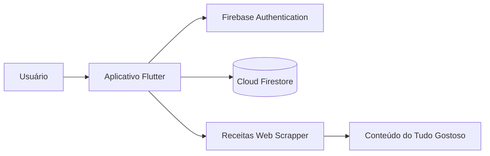
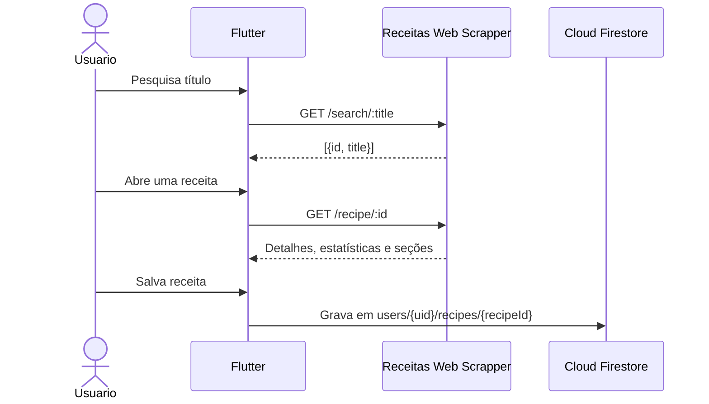

# Receitas, é Tudo Gostoso!

Aplicativo mobile de caderno digital de receitas desenvolvido com Flutter. A busca e a consulta de detalhes usam **exclusivamente** a API [Receitas Web Scrapper](https://github.com/carol-caires/receitas-web-scrapper), que fornece conteúdo do site Tudo Gostoso. Firebase Authentication e Cloud Firestore atendem à autenticação e ao caderno privado.

**Versão:** 1.0.0  
**Plataforma implementada:** Android  
**Projeto Firebase:** `receitasetudogostoso`  
**Nome público informado:** `project-1051356694302`

## 1. Introdução

### 1.1 Propósito

Este documento descreve o escopo, os requisitos, a arquitetura, a modelagem de dados e as instruções para configurar, executar e validar o aplicativo e a API.

### 1.2 Escopo

- Criar conta e autenticar por e-mail e senha.
- Pesquisar receitas pelo título na Receitas Web Scrapper.
- Consultar detalhes pelo identificador recebido na busca.
- Salvar receitas no caderno privado do usuário.
- Criar receitas manualmente e ler, editar ou excluir receitas salvas.

### 1.3 Termos e acrônimos

| Termo | Definição |
| --- | --- |
| API | Interface HTTP da Receitas Web Scrapper. |
| CRUD | Create, Read, Update e Delete: criar, ler, atualizar e excluir. |
| Firebase Auth | Serviço de autenticação do Firebase. |
| Firestore | Banco de dados NoSQL do Firebase. |
| RF / RNF | Requisito funcional / requisito não funcional. |

## 2. Descrição geral

### 2.1 Perspectiva do sistema

O aplicativo consulta a Receitas Web Scrapper pelos endpoints `GET /search/:title` e `GET /recipe/:id`. Os dados completos obtidos pela API podem ser copiados para o caderno privado do usuário no Firestore. A API não é substituída por outra fonte de receitas.



### 2.2 Usuários e ambiente operacional

Usuários autenticados mantêm um caderno separado. O aplicativo Android acessa um projeto Firebase configurado para este app e a API executada localmente ou publicada em uma URL acessível ao dispositivo.

### 2.3 Restrições

- O README da API não informa um endereço de serviço hospedado. Portanto, a URL base é configurável por `RECIPES_API_BASE_URL`.
- Por padrão, a aplicação Android usa `http://10.0.2.2:3000`, o endereço do computador host visto pelo emulador Android. Para um dispositivo físico, use o endereço IP da máquina na rede ou publique a API em HTTPS.
- O Firebase project ID da URL do Console é `receitasetudogostoso`. `project-1051356694302` é o nome público informado e não substitui o project ID nos `FirebaseOptions`.
- As credenciais do aplicativo Firebase (API Key, App ID e Sender ID) não foram fornecidas nem são inferidas a partir do nome público. Devem ser obtidas na configuração do app Android registrado no Console.

## 3. Arquitetura do sistema

### 3.1 Organização do código

| Caminho | Responsabilidade |
| --- | --- |
| `lib/main.dart` | Inicialização Flutter/Firebase. |
| `lib/app/` | Tema, entrada autenticada e tela de configuração pendente. |
| `lib/firebase/firebase_config.dart` | Opções de Firebase fornecidas por `--dart-define`. |
| `lib/models/recipe.dart` | Receita, seções de ingredientes/instruções e estatísticas. |
| `lib/services/recipe_api_service.dart` | Chamadas HTTP exclusivas à Receitas Web Scrapper. |
| `lib/services/recipe_repository.dart` | CRUD do caderno Firestore por usuário. |
| `lib/screens/` | Telas de autenticação, busca, caderno, detalhes e edição. |
| `firestore.rules` | Autorização por UID e validação básica de documentos. |
| `test/` | Testes do modelo e dos endpoints/formatos da API. |

### 3.2 Fluxo de pesquisa e visualização



### 3.3 Modelo de dados da API e do Firestore

Detalhes de receita seguem os nomes e a estrutura descritos pela API:

| Campo | Tipo | Conteúdo |
| --- | --- | --- |
| `title` | string | Título retornado pela API. |
| `stats` | map | `prepare_time_minutes`, `portion_output` e `favorites`. |
| `ingredients` | array de maps | Cada seção tem `title` e `items` (array de strings). |
| `instructions` | array de maps | Cada seção tem `title` e `items` (array de strings). |

O Firestore guarda esses campos junto de `sourceId` em `users/{uid}/recipes/{recipeId}`. Receitas encontradas na API usam o identificador da API como origem e uma chave estável por usuário. Receitas manuais são salvas com `title`, `stats`, `ingredients` e `instructions`, usando a seção `default` quando necessário.

## 4. Requisitos

### 4.1 Requisitos funcionais

| ID | Requisito | Critério de aceite |
| --- | --- | --- |
| RF-01 | Autenticar usuários. | Cadastro, login e logout com Firebase Authentication. |
| RF-02 | Pesquisar receitas. | Busca usa `GET /search/:title` e interpreta a lista `{id, title}`. |
| RF-03 | Consultar detalhes. | Ao abrir um resultado, usa `GET /recipe/:id` e exibe estatísticas e seções. |
| RF-04 | Salvar e ler o caderno. | Receitas são gravadas/lidas no caminho privado do UID autenticado. |
| RF-05 | Criar e editar receita própria. | O formulário salva nome, ingredientes e etapas no formato por seções. |
| RF-06 | Excluir receita. | Exclusão solicita confirmação e remove o documento selecionado. |

### 4.2 Requisitos não funcionais

| ID | Requisito |
| --- | --- |
| RNF-01 | Interface responsiva com estados de carregamento, erro e lista vazia. |
| RNF-02 | Código separado entre telas, modelo, API e repositório. |
| RNF-03 | Regras Firestore limitam leitura e escrita ao proprietário do UID. |
| RNF-04 | Respostas HTTP inválidas ou erros da API são apresentados explicitamente. |

## 5. Regras de negócio e segurança

1. Cada usuário lê e modifica apenas `users/{seu UID}/recipes`.
2. A pesquisa recebe identificadores da rota de busca e solicita detalhes usando esses identificadores.
3. Ingredientes e instruções são persistidos como arrays de seções `{title, items}`; estatísticas ficam em `stats`.
4. Receitas da API são copiadas ao caderno para que a leitura dele não dependa de chamadas à API.
5. As regras Firestore devem ser publicadas no projeto `receitasetudogostoso`.
6. A configuração Firebase do cliente não substitui regras de acesso no Firestore.

Publique as regras após autenticar a Firebase CLI e selecionar o projeto:

```powershell
firebase login
firebase use receitasetudogostoso
firebase deploy --only firestore:rules
```

## 6. Instalação e execução

### 6.1 Pré-requisitos

- Flutter SDK, Android SDK e emulador ou dispositivo Android;
- Node.js/npm para executar a API;
- Firebase CLI;
- Firebase Authentication por e-mail/senha e Cloud Firestore habilitados no projeto `receitasetudogostoso`;
- aplicativo Android registrado no projeto, com credenciais Firebase.

### 6.2 Iniciar a Receitas Web Scrapper

Em um terminal, clone e inicie a API conforme as instruções do repositório:

```powershell
git clone https://github.com/carol-caires/receitas-web-scrapper.git
Set-Location receitas-web-scrapper
npm install
npm start
```

O serviço usa a porta `3000` por padrão, ou a porta configurada pela variável `PORT`.

### 6.3 Configurar e iniciar o aplicativo

Na pasta do aplicativo, instale as dependências:

```powershell
flutter pub get
```

No Firebase Console, abra o projeto `receitasetudogostoso`, registre ou selecione o app Android com o application ID deste projeto e copie sua API Key, App ID e Sender ID. Com a API rodando no mesmo computador e um emulador Android ativo:

```powershell
flutter run `
  --dart-define=FIREBASE_API_KEY=SEU_API_KEY `
  --dart-define=FIREBASE_APP_ID=SEU_APP_ID `
  --dart-define=FIREBASE_MESSAGING_SENDER_ID=SEU_SENDER_ID `
  --dart-define=RECIPES_API_BASE_URL=http://10.0.2.2:3000
```

`FIREBASE_PROJECT_ID` tem como padrão `receitasetudogostoso`; só informe-o se o project ID real no Console for diferente. Para um dispositivo físico, substitua `10.0.2.2` pelo IP da máquina que executa a API, por exemplo `http://192.168.1.20:3000`. Para API hospedada, use sua URL HTTPS:

```powershell
--dart-define=RECIPES_API_BASE_URL=https://seu-dominio
```

Em Windows desktop, use `http://localhost:3000`. A URL precisa apontar para a raiz da API; o aplicativo acrescenta `/search/:title` e `/recipe/:id`.

Somente a configuração de depuração Android permite HTTP para viabilizar o servidor local de desenvolvimento. Em builds de distribuição, publique a API em HTTPS; tráfego HTTP claro permanece desabilitado.

### 6.4 Contrato usado pelo aplicativo

- `GET /search/:title` retorna `[{ "title": "...", "id": "..." }]`.
- `GET /recipe/:id` retorna `title`, `stats`, `ingredients` e `instructions`, com seções no formato `{ "title": "...", "items": ["..."] }`.
- Respostas HTTP de erro contendo `erro` são mostradas como falhas de consulta.

## 7. Validação

```powershell
flutter test
flutter analyze
flutter build apk --debug
```

Verifique manualmente: autenticação; busca pelo título; abertura de resultado e exibição das seções; salvamento; leitura do caderno; criação/edição/exclusão; resposta vazia; falha HTTP; e isolamento de dados entre duas contas.

## 8. Histórico de versões

| Versão | Data | Modificação |
| --- | --- | --- |
| 1.0.0 | 2026-10-22 | Caderno Flutter/Firebase e integração com a Receitas Web Scrapper. |
